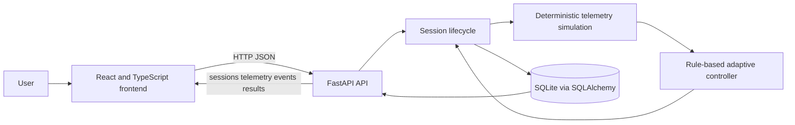

# GrindSense

**From speed control to outcome control.** GrindSense is a software-only grinding simulation prototype with mechanical concept CAD, prepared by Team Nexora for AtomQuest 2026 Round 2.

> **Prototype status:** GrindSense is a software simulation with concept CAD. No physical mixer-grinder, motor controller, microphone, or sensors are connected. Telemetry, texture scores, thresholds, interlocks, and outcomes are generated or evaluated in software and are not physical measurements or certified safety protection.

## Contents

- [Overview](#overview)
- [Problem and proposed approach](#problem-and-proposed-approach)
- [Features](#features)
- [How the adaptive simulation works](#how-the-adaptive-simulation-works)
- [Architecture and technology](#architecture-and-technology)
- [Frontend](#frontend)
- [Backend](#backend)
- [Mechanical concept and CAD](#mechanical-concept-and-cad)
- [Repository structure](#repository-structure)
- [Team Nexora](#team-nexora)
- [Setup and run](#setup-and-run)
- [API](#api)
- [Testing and validation](#testing-and-validation)
- [Safety, limits, and future work](#safety-limits-and-future-work)
- [Round 2 documents](#round-2-documents)

## Overview

GrindSense demonstrates an outcome-oriented grinding workflow. A user configures a virtual session and chooses a coarse, medium, fine, or smooth target. A deterministic simulation generates virtual telemetry, applies explainable rule-based control decisions, and records session events and estimates in SQLite. The interface presents setup, live-session, results, history, and texture-library screens.

The repository also includes SolidWorks concept parts and an assembly. These CAD files document a mechanical concept; they do not establish fabrication, fit validation, material qualification, or operational safety.

## Problem and proposed approach

Fixed-speed grinding offers limited visibility into changing ingredient load and grinding progress. GrindSense explores a software workflow that makes a target texture explicit, presents generated process indicators, and demonstrates how adaptive rules might respond to simulated conditions. Physical texture quality, ingredient heating, energy use, and appliance performance have not been measured.

## Features

- Configure recipe/task, ingredients, quantity, water, preparation, smoothness, target texture, adaptive mode, and demonstration scenario.
- Run deterministic, seeded virtual sessions with generated current, load, temperature, vibration, acoustic-signature, torque-demand, speed, texture, and progress values.
- Demonstrate rule-based speed, intensity, and pulse/rest adjustments with explanatory events.
- Show threshold warnings, predictive trend warnings, and simulated stop outcomes.
- Exercise simulated jar, lid, and attachment interlocks.
- Persist sessions, telemetry, and events using SQLite; view results and session history.
- Inspect concept CAD for the blade assembly, lid, mixer jar, motor housing, and assembly.

## How the adaptive simulation works

A session seed and tick drive deterministic pseudo-random variation in `backend/app/simulation.py`. Task and ingredient factors, intensity, tick, and the chosen scenario influence the generated values. Texture progress and estimated texture index are also computed in software. The selected target has a backend completion threshold: coarse 28, medium 52, fine 76, and smooth 94 on the simulated texture index.

`backend/app/controller.py` applies rule-based decisions in priority order: temperature, load, vibration, acoustic signature, then gradual intensity increase under low simulated load and low progress. It can lower virtual speed or intensity and change the pulse/rest pattern. Predictive warnings use up to five recent simulated readings (at least three) and a short trend estimate; prediction events do not directly change controls or session state. Configured thresholds and interlock outcomes are demonstration parameters, not validated appliance limits or hardware protection.

See [the control strategy](docs/control_strategy.md) for details.

## Architecture and technology



| Area | Implementation |
|---|---|
| Frontend | React 19, TypeScript, Vite |
| Backend | Python, FastAPI, Pydantic |
| Persistence | SQLAlchemy with SQLite by default |
| UI assets | Existing downloaded design assets in `frontend/public/assets/` |
| Mechanical concept | SolidWorks part and assembly files under `deliverables/cad/` |

More detail is in [architecture.md](docs/architecture.md).

## Frontend

The Vite application in `frontend/` includes setup, live session, results, session history, and texture library views. It calls the backend through `frontend/src/api.ts`; `VITE_API_URL` can override the default `http://localhost:8000`. The interface labels readings as simulated estimates and identifies the acoustic and torque values as proxies.

## Backend

The FastAPI application in `backend/app/main.py` manages session lifecycle, API requests, persistence, generated telemetry, control decisions, events, and results. `backend/app/simulation.py` creates the virtual readings; `backend/app/controller.py` evaluates adaptive actions, warnings, trend warnings, and demo stop conditions. The API defaults to a local SQLite database and can be configured with environment variables described in [backend/README.md](backend/README.md).

## Mechanical concept and CAD

`deliverables/cad/GrindSense_Concept/` contains the SolidWorks concept assembly and parts for the blade assembly, lid, mixer jar, and motor housing. CAD deliverables represent a concept only. Physical design review, fit and clearance checks, material selection, manufacturability review, guarded prototyping, and safety evaluation remain future work.

## Repository structure

```text
GrindSense/
├── README.md
├── backend/
│   ├── app/
│   │   ├── controller.py
│   │   ├── main.py
│   │   └── simulation.py
│   ├── tests/
│   ├── README.md
│   ├── requirements.txt
│   └── requirements-dev.txt
├── docs/
├── experiments/
├── frontend/
│   ├── public/assets/
│   ├── src/
│   └── tests/
└── deliverables/cad/GrindSense_Concept/
```

## Team Nexora

| S. No. | Student Name | Role |
|---:|---|---|
| 1 | Sai Spoorthy Eturu | Team Lead & Product/Repository Coordinator |
| 2 | Duddala Srija | Mechanical Concept & CAD Engineer |
| 3 | Katakam Sahithi Rithvika | UI/UX & Frontend Integration Engineer |
| 4 | Kommera Hari Hansika | Backend Simulation & Adaptive-Control Engineer |
| 5 | Gowravarapu Shamithri | Integration Support & Team Collaboration Coordinator |

## Setup and run

### Backend

From the repository root, create a virtual environment and install runtime requirements:

```sh
cd backend
python -m venv .venv
. .venv/bin/activate
python -m pip install -r requirements.txt
uvicorn app.main:app --reload
```

On Windows PowerShell, activate with `.venv\Scripts\Activate.ps1`. The API listens at `http://localhost:8000`; interactive documentation is at `http://localhost:8000/docs`.

### Frontend

In another terminal:

```sh
cd frontend
npm install
npm run dev
```

Vite prints the local development URL. The default API base is `http://localhost:8000`; set `VITE_API_URL` in `frontend/.env` only if the API is elsewhere. Configure `GRINDSENSE_CORS_ORIGINS` on the backend if the frontend origin differs from its default `http://localhost:5173`.

## API

The full request fields, lifecycle behavior, response examples, and environment settings are documented in [backend/README.md](backend/README.md). Endpoints currently implemented include:

| Method | Path | Purpose |
|---|---|---|
| `GET` | `/api/health` | Report API simulation mode and hardware connection status |
| `POST` | `/api/sessions` | Create a session |
| `GET` | `/api/sessions` | List session history |
| `GET` | `/api/sessions/{sid}` | Retrieve a session |
| `POST` | `/api/sessions/{sid}/start` | Start a session |
| `POST` | `/api/sessions/{sid}/pause` | Pause a running session |
| `POST` | `/api/sessions/{sid}/resume` | Resume a safe paused session |
| `POST` | `/api/sessions/{sid}/stop` | Stop a running or paused session |
| `POST` | `/api/sessions/{sid}/interlocks` | Update simulated interlock states |
| `GET` | `/api/sessions/{sid}/telemetry` | Read generated telemetry |
| `GET` | `/api/sessions/{sid}/events` | Read session events |
| `GET` | `/api/sessions/{sid}/results` | Read session summary and telemetry |
| `POST` | `/api/simulation/scenario` | Set defaults for later sessions |

## Testing and validation

Backend test files are in `backend/tests/`; install `backend/requirements-dev.txt` and run `python -m pytest -q` from `backend/`. A frontend display test is in `frontend/tests/display.test.mjs` and can be run with `node --test tests/display.test.mjs` from `frontend/`. The frontend production build command is `npm run build` from `frontend/`.

These are available validation commands, not a claim that tests or builds were run while preparing this documentation. See [the validation plan](docs/validation_plan.md) for software and future hardware validation scope.

## Safety, limits, and future work

All values, warning thresholds, predictive notices, outcomes, and jar/lid/attachment interlocks are simulated. Software interlocks are not physical sensors, guards, emergency stops, or certified safety systems. The prototype does not control an appliance. No physical heat reduction, energy savings, real-world texture accuracy, sensor accuracy, or safety performance is claimed.

Future work includes software verification against a recorded final commit, sensor calibration on a guarded and isolated low-voltage test rig, review of a separate motor-control subsystem, repeatable baseline and adaptive trials, CAD design validation, and independent hardware safety review before any powered grinding. See [safety and risk](docs/safety_and_risk.md) and [validation plan](docs/validation_plan.md).

## Round 2 documents

- [AtomQuest 2026 Round 2 project report](docs/ATOMQUEST_ROUND2.md)
- [Software architecture](docs/architecture.md)
- [Adaptive control strategy](docs/control_strategy.md)
- [Safety and risk](docs/safety_and_risk.md)
- [Validation plan](docs/validation_plan.md)
- [Experiments overview](experiments/README.md)
- [Simulated telemetry data dictionary](experiments/data_dictionary.md)

The competition progress report PDF is a separate submission deliverable and is intentionally not stored in this repository.
