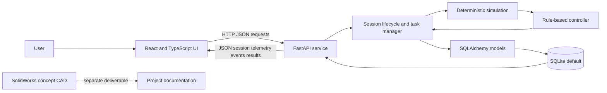

# GrindSense software architecture

## Scope

This document describes the current repository implementation. It is a software-only simulation with mechanical concept CAD. No hardware or physical sensors are connected.

## Components

- **React frontend:** `frontend/src/App.tsx` implements setup, live session, results, history, and texture library views. It polls the API for current session, telemetry, and events.
- **API client:** `frontend/src/api.ts` wraps `fetch`, uses `VITE_API_URL` or `http://localhost:8000`, and defines response types.
- **FastAPI service:** `backend/app/main.py` validates requests with Pydantic, exposes routes, manages session lifecycle and background simulation tasks, and serializes stored records.
- **Simulation engine:** `backend/app/simulation.py` uses session state, scenario, tick, and seed to generate deterministic virtual readings and target completion.
- **Adaptive controller:** `backend/app/controller.py` computes rule-based virtual speed, intensity, and pulse/rest decisions; warning and critical conditions; and trend warning candidates.
- **Persistence:** SQLAlchemy models in `backend/app/main.py` store sessions, telemetry, and events. SQLite is the default; `GRINDSENSE_DATABASE_URL` can override it.
- **Mechanical concept:** SolidWorks artefacts under `deliverables/cad/GrindSense_Concept/` are separate concept CAD files, not runtime components.

## Architecture diagram

## Session data flow

1. The frontend posts a configuration to `POST /api/sessions`. Request validation checks task, ingredients, numeric fields, texture target, scenario, and interlock fields.
2. The backend stores a `grinding_sessions` row and returns its current state.
3. The frontend calls `POST /api/sessions/{sid}/start`. If simulated interlock booleans are unsafe, the API records a safety event and rejects start with `409`.
4. A backend task generates one reading per tick. It stores telemetry, evaluates predictive warnings and controller decisions, records events, updates progress, and checks simulated warnings/stops and target completion.
5. The frontend polls `GET /api/sessions/{sid}`, `/telemetry`, and `/events` for the live view.
6. On terminal state, the frontend reads `/results`, which summarizes stored readings and events. `GET /api/sessions` supplies history.

## Persistence model

- `grinding_sessions`: selected configuration, simulated interlock states, scenario and seed, lifecycle status, progress, virtual control state, and summary timestamps.
- `telemetry_records`: timestamped generated values for current, load, temperature, vibration, acoustic proxy, torque proxy, speed, texture index, and progress.
- `session_events`: event type, severity, explanation, and optional previous/new state snapshots.

The backend also contains compatibility helpers that add selected newer columns to existing SQLite databases. These helpers do not connect to hardware.

## API communication and lifecycle

Requests and responses use JSON. FastAPI interactive documentation is available at `/docs`, with the OpenAPI schema at `/openapi.json` when the service runs. Lifecycle states include created, running, paused, completed, stopped, and safety_stopped. Terminal sessions cannot restart. Start and resume enforce the simulated interlocks.

## Source map

| Path | Responsibility |
|---|---|
| `frontend/src/App.tsx` | UI screens and API-driven workflow |
| `frontend/src/api.ts` | HTTP requests and frontend data types |
| `frontend/src/display.ts` | Formatting and UI display helpers |
| `backend/app/main.py` | API routes, SQLAlchemy models, lifecycle/task handling, results |
| `backend/app/simulation.py` | Deterministic telemetry and estimated texture completion |
| `backend/app/controller.py` | Adaptive control, warning and simulated stop rules |
| `backend/tests/` | Backend API and simulation test code |
| `frontend/tests/display.test.mjs` | Display helper test code |

## Configuration

- `GRINDSENSE_DATABASE_URL`: SQLAlchemy database URL; default `sqlite:///./grindsense.db` relative to the backend working directory.
- `GRINDSENSE_TICK_SECONDS`: simulation interval; default 1 second with a minimum of 0.25 seconds.
- `GRINDSENSE_CORS_ORIGINS`: comma-separated allowed origins; default `http://localhost:5173`.
- `VITE_API_URL`: frontend API base URL; default `http://localhost:8000`.

All telemetry and control data remain simulated estimates. HTTP success indicates API behavior only, not appliance interaction.
